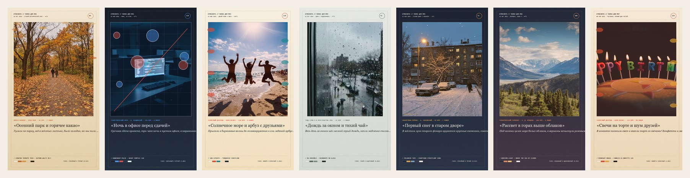

# АТМОСФЕРА — Личный дневник ощущений
**GENESIS HACKATHON 2026 // ARTTECH // Make the Invisible Visible_**

> Личный мультимодальный дневник, который превращает один день — **свободный текст, фотографии и песню** — в живое воспоминание (анимированную видеосцену `9:16` с музыкой, постер высокого разрешения и голосовую озвучку) по правилам единой визуальной системы и сохраняет всё в отдельную **Папку дня**.



---

## Быстрый старт (проверка прототипа за 10 секунд)

* **Живая веб-версия (GitHub Pages):** **[https://looxmaxx.github.io/atmosfera-arttech/](https://looxmaxx.github.io/atmosfera-arttech/)**
* **Репозиторий проекта:** **[https://github.com/looxmaxx/atmosfera-arttech](https://github.com/looxmaxx/atmosfera-arttech)**

Прототип написан на чистом модульном JavaScript (ES Modules, HTML5 Canvas, Web Audio API, Web Speech API, MediaRecorder, IndexedDB) и **не требует установки зависимостей, сборки или API-ключей**.

### Вариант 1: Локальный запуск одной командой
Откройте терминал в папке проекта и запустите встроенный веб-сервер Python (или любой статический сервер):

```bash
python -m http.server 8080
```

После этого откройте в браузере: **[http://localhost:8080](http://localhost:8080)**

*(При первом открытии прототип автоматически проанализирует и соберёт 7 демонстрационных дней с разным настроением).*

---

## Навигация по материалам сдачи (Раздел 09 кейса)

| Материал из требований кейса | Где находится в репозитории |
| :--- | :--- |
| **1. Рабочий прототип и инструкция** | Веб-приложение в корне репозитория (`index.html`, `css/`, `js/`) |
| **2. Примеры дней (7 папок с результатами)** | Папка [`examples/`](examples/) — 7 сгенерированных папок дней с постерами `memory_poster.jpg` и записями `note.txt` + склеенная лента [`examples/feed_strip_7_days.jpg`](examples/feed_strip_7_days.jpg) |
| **3. Описание до 1 страницы** | [`docs/DESCRIPTION_1PAGE.md`](docs/DESCRIPTION_1PAGE.md) — идея, аудитория, правила визуальной системы и влияние ввода |
| **4. Художественные приёмы и референсы** | [`docs/ARTISTIC_TECHNIQUES.md`](docs/ARTISTIC_TECHNIQUES.md) — 6 техник (Моне, Кандинский, Матисс, Суми-э/Ма, Тарковский/Kodachrome, Фридрих/Таррелл) |
| **5. Использованные инструменты и вклад** | [`docs/TOOLS_AND_CREDITS.md`](docs/TOOLS_AND_CREDITS.md) — стек, алгоритмы, лицензии CC0 |
| **6. Сценарий видео до 3 минут** | [`docs/VIDEO_SCRIPT_3MIN.md`](docs/VIDEO_SCRIPT_3MIN.md) — поминутный сценарий демонстрации |

---

## Примеры 7 сгенерированных папок дней («Проверка лентой»)

Все 7 дней подчиняются единым конструктивным инвариантам серии (формат `9:16`, архивное паспарту, верхний штамп с круглой печатью темпа/лада и нижний «Паспорт ощущения» с 5 плашками палитры и звуковой партитурой), но каждый день имеет собственную пластику, палитру и ритм:

| № | Папка дня (3–7 слов) | Художественный приём | Песня (BPM · Лад) | Голос озвучки | Постер |
| :-: | :--- | :--- | :--- | :--- | :-: |
| **01** | **«Осенний парк и горячее какао»** | Импрессионизм · *Клод Моне* | `84 BPM · F мажор` (джаз-вальс) | Спокойный и тёплый (`0.91×`) | [Постер](examples/01%20—%20Осенний%20парк%20и%20горячее%20какао/memory_poster.jpg) |
| **02** | **«Ночь в офисе перед сдачей»** | Супрематизм и сетка · *В. Кандинский* | `128 BPM · A минор` (электроника) | Собранный и чёткий (`1.08×`) | [Постер](examples/02%20—%20Ночь%20в%20офисе%20перед%20сдачей/memory_poster.jpg) |
| **03** | **«Солнечное море и арбуз с друзьями»** | Солнечный декупаж · *Анри Матисс* | `120 BPM · D мажор` (фанк / поп) | Живой и солнечный (`1.06×`) | [Постер](examples/03%20—%20Солнечное%20море%20и%20арбуз%20с%20друзьями/memory_poster.jpg) |
| **04** | **«Дождь за окном и тихий чай»** | Тушь Суми-э и пространство *«Ма» (間)* | `62 BPM · E минор` (пианино) | Тихий и задумчивый (`0.86×`) | [Постер](examples/04%20—%20Дождь%20за%20окном%20и%20тихий%20чай/memory_poster.jpg) |
| **05** | **«Первый снег в старом дворе»** | Аналоговая плёнка · *А. Тарковский* | `92 BPM · C мажор` (ретро-синт) | Спокойный и тёплый (`0.91×`) | [Постер](examples/05%20—%20Первый%20снег%20в%20старом%20дворе/memory_poster.jpg) |
| **06** | **«Рассвет в горах выше облаков»** | Романтический свет · *К. Д. Фридрих* | `100 BPM · G мажор` (пост-рок) | Воздушный и вдохновенный (`0.95×`) | [Постер](examples/06%20—%20Рассвет%20в%20горах%20выше%20облаков/memory_poster.jpg) |
| **07** | **«Свечи на торте и шум друзей»** | Солнечный декупаж · *Анри Матисс* | `124 BPM · B♭ мажор` (танец) | Живой и солнечный (`1.06×`) | [Постер](examples/07%20—%20Свечи%20на%20торте%20и%20шум%20друзей/memory_poster.jpg) |

---

## Как работает мультимодальный синтез

```
┌─────────────────────────┐   ┌─────────────────────────┐   ┌─────────────────────────┐
│      01 // ТЕКСТ        │   │       02 // ФОТО        │   │      03 // МУЗЫКА       │
│ Семантика и ритм фраз:  │   │ Компьютерное зрение:    │   │ DSP (Web Audio API):    │
│ • Валентность [-1..+1]  │   │ • 5 доминирующих цветов │   │ • Темп (BPM по атакам)  │
│ • Теплота и Напряжение  │   │   (k-means в RGB)       │   │ • Лад (Мажор / Минор    │
│ • Ностальгия, время,    │   │ • Яркость и контраст    │   │   по хроматограмме)     │
│   цитата и имя папки    │   │ • Теплота освещения     │   │ • Энергия RMS и тембр   │
└───────────┬─────────────┘   └───────────┬─────────────┘   └───────────┬─────────────┘
            └──────────────────┐          │          ┌──────────────────┘
                               ▼          ▼          ▼
                    ┌───────────────────────────────────────────┐
                    │      04 // ЕДИНАЯ ВИЗУАЛЬНАЯ СИСТЕМА      │
                    │ • Выбор художественного приёма (1 из 6)   │
                    │ • Сплав палитры фото и тона настроения    │
                    │ • Расчёт воздуха паспарту и шага монтажа  │
                    │ • Подбор тембра и темпа голоса озвучки    │
                    │ • Генерация «Объяснимой логики» решения   │
                    └─────────────────────┬─────────────────────┘
                                          ▼
                    ┌───────────────────────────────────────────┐
                    │         05 // ПАПКА ДНЯ (.ZIP / FS)       │
                    │ 📁 «Осенний парк и горячее какао»/        │
                    │  ├─ note.txt                              │
                    │  ├─ memory_poster.jpg (720×1280)          │
                    │  ├─ memory_video.webm (анимация + звук)   │
                    │  ├─ photos/ (photo_1.jpg...)              │
                    │  ├─ music/ (track.wav + analysis.json)    │
                    │  ├─ voiceover/ (voice_preset.json)        │
                    │  └─ visual_passport.json                  │
                    └───────────────────────────────────────────┘
```

---

## Структура проекта

```
atmosfera/
├── index.html                  # Точка входа SPA-приложения
├── css/
│   └── style.css               # Стили архива, студии записи и карточки дня
├── js/
│   ├── app.js                  # Маршрутизатор и UI (Архив, Новая запись, День, Система)
│   ├── analyze.js              # Анализ текста, k-means палитра фото, WebAudio DSP музыки
│   ├── visual-system.js        # 6 художественных приёмов, правила формы и объяснимая логика
│   ├── renderer.js             # Canvas 2D рендерер (60 FPS сцена + экспорт видео .webm)
│   ├── voice.js                # Озвучка текста голосом под атмосферу дня + запись с микрофона
│   ├── zip.js                  # Сборщик Папки дня в .zip и через File System Access API
│   ├── storage.js              # Локальное хранилище архива (IndexedDB)
│   └── demo-days.js            # 7 предзагруженных дней с разным настроением
├── demo/
│   ├── photos/                 # 21 демонстрационная фотография (d1_1.jpg .. d7_3.jpg)
│   └── audio/                  # 7 оригинальных CC0 музыкальных дорожек + LICENSE.txt
├── examples/                   # 7 готовых папок дней с постерами + лента feed_strip_7_days.jpg
├── docs/                       # Документация для сдачи (1-страничное описание, приёмы, сценарий)
└── tools/                      # Python-скрипты генерации CC0-аудио и рендера примеров
```
